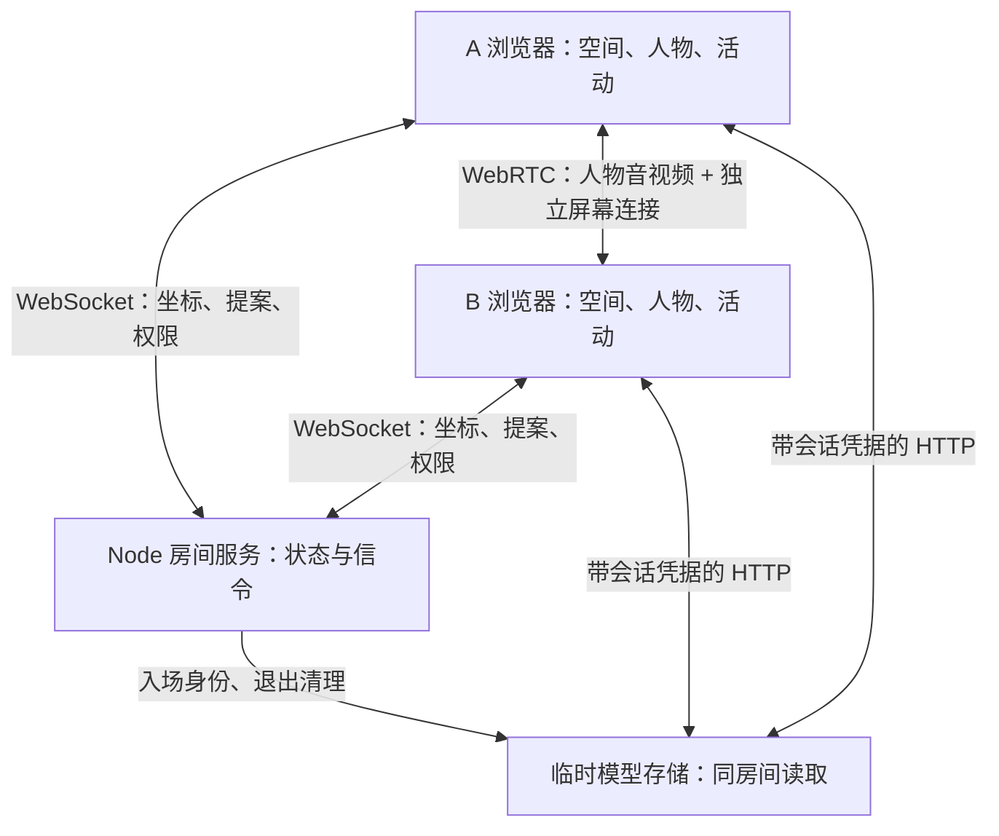

# Rove v0.2 技术架构

日期：2026-10-20。实现仓库：[venividici/Rove](https://github.com/venividici/Rove)。

本版目标是把“自己的房间、对方的影像、一起看的内容”接到同一场双人会话中。它沿用原 [产品设想](../rove-overview.html) 中的 A′/B′ 主场选择、先同意后进入、主场 AR / 来访 VR、二维视频化身与屏幕分享的 MVP 路径。

“已实现”指代码包含该行为；自动测试、双端浏览器和实体设备分别验收，具体结果见 [VALIDATION.md](VALIDATION.md)。

## 1. 组件与数据路径

WebRTC 可经配置的 TURN 中继；图中的媒体连接不保证网络直连。姿态与触碰仍走服务端 WebSocket，便于在同一房间状态下校验版本、权限、频率和位置。模型文件通过 HTTP 传输，避免大二进制阻塞姿态通道。

服务单进程运行，房间和模型均在内存中。没有账号、数据库、多副本房间协调、持久空间库或会话恢复。服务重启会结束现有会话。

## 2. 会话身份与主场分开

`Member.role` 保留创建者 `host` / 加入者 `guest`，用于会话生命周期和摄像头 perfect negotiation 的确定性角色。创建者退出仍结束房间。

`RoomSpace.ownerId` 表示此次空间由谁提供。双方均可提出自己的尺寸空间或模型；接受后，`scene.setRole()` 根据空间提供者映射主场/来访入口。切换主场不会交换 WebRTC 的 polite / impolite 身份。

来访者提供的模型在其退出后删除；仍在房间的创建者回到新版本的示例空间。新版本需要重新确认，旧位置和触碰许可不能沿用。

## 3. 空间事务与坐标版本

`SpaceConfig` 包含来源、名称、米制宽深高、资产标识和显式 `scale → yaw → offset`。`RoomSpace` 在其上增加服务端控制的 `ownerId` 与 `revision`。

用户在本地准备与预览空间；参数改变会失效上一份预览确认，进行中的上传也会取消。只有确认过的配置可以发出提案。另一位参与者必须在 60 秒内明确接受或拒绝，发起者不能替对方接受。

接受时服务端增加坐标版本，并清除位姿、接触、触碰许可和共享屏幕。双方各自完成模型加载/渲染替换，明确确认当前 revision 后进入 `spaceReady`。双方 ready 才接受有效位置和触碰许可。初始 revision 0 的示例空间沿用直接体验路径。

客户端以房间、加载序号、文件序号、草稿版本和取消信号隔离异步操作。新房间、修改文件、改变参数、停止或退出后，迟到 fetch、渲染结果或权限结果不能恢复旧场景与采集。成功加载本身不代表用户确认。

## 4. 模型与范围

`shared/glb.ts` 在上传端和浏览器端执行相同静态 GLB 预检。`space-model.ts` 使用真实 Three.js GLTFLoader 读取内嵌几何和节点变换，并检查最终包围盒；加载器只允许已验证的内嵌贴图 blob。限制见 [PROTOCOL.md](PROTOCOL.md)。

GLB 检查保留原始单位。用户明确指定一单位对应多少米、水平朝向，以及是否以模型中心为共享原点、将最低点置于地面。场景不再暗中做一次居中或比例推断。

显示宽深是原包围盒经旋转和比例变换的保守外包范围。它不等于净空，不提供家具碰撞、可通行区域识别或现实中的安全边界。尺寸空间根据人工输入生成地板、参考墙、网格和标记。

新几何、屏幕与标记准备成功后才替换旧画面，旧 GPU 资源和贴图被释放；失败保持原画面但禁用新空间互动，显示重试入口。模型版本改变会清除旧远端人物位置。

## 5. 人物与视角

桌面通过键鼠生成头部与双手控制点，默认观察视角可环绕查看空间；第一人称使用人物头部的位置和朝向。桌面输入是手动模拟，不是摄像头动作识别。

远端摄像头作为 2D 视频平面置于对方头部附近，朝向本地观察者，并保持视频宽高比。它随实际收到的姿态定位；画面必须有有效视频轨、播放中且帧持续更新。相机关闭、视频暂停或位置过期时回退为简化人物。视频平面不提供立体人体形状或真实身高估计。

远端姿态带 `spaceRevision` 和递增 `seq`。客户端与服务端均拒绝旧版本/旧序号，不把加载中的旧坐标重新标成新版本。过期或失效追踪会淡出人物、取消待确认触碰并恢复普通语音。

## 6. 人物媒体与共同屏幕

`MediaLink` 管理相机与麦克风，采用 WebRTC perfect negotiation。`ScreenShare` 维护独立的第二条 PeerConnection，不替换人物视频发送器，也不共享接收 MediaStream。

屏幕由一次直接用户点击触发 `getDisplayMedia()`，首先只保留本地捕获；服务端授予唯一 presenter 后再发送轨道。当前共享用 `presentationRevision` 标识，screen SDP/ICE 必须匹配版本，只有 presenter 发 offer，另一方回答。停止、换人、换空间后，旧 offer/ICE 不会串入新分享。

接收人物音频和内容音频使用不同 video 元素。分享来源是否提供声音由浏览器决定。浏览器自动播放受限时提供明确播放按钮。结束分享保留人物通话；仅关闭本机设备不会切断对方的共享屏幕。全会话暂停或退出关闭所有本地采集与连接。

24 秒原创测试片继续用于检查共享播放时钟。屏幕分享期间本地暂停样片并禁用播放操作；实时屏幕传输不承诺影视级帧同步、远端控制、DRM 兼容或内容平台集成。

## 7. 空间声音

用户明确开启后，Web Audio 使用真实远端麦克风轨道建立 HRTF PannerNode。听者位置/朝向来自本地人物头部，声源来自远端头部；观察镜头不会偷偷改变听觉位置。

仅在音频图运行、轨道有效、双方位置有效时静音原 video 的普通声音，避免重复播放。无位置、丢失追踪、暂停、图失败或退出时断开 HRTF 路由并恢复普通播放。屏幕内容声音不经过人物 HRTF。

## 8. WebXR 手动对齐

XR 读取真实 `local-floor` 头部与 grip/wrist 位姿。初次进入、换空间或参考空间 reset 后，旧对齐失效。用户站到约定入口、面向约定前方，触发对齐：由实际头部的水平位置和 yaw 得到一个统一刚体变换，头部与双手使用同一变换，保留物理地面高度。

AR 隐藏完整房间几何，保留人物、共同屏幕和标记；VR 显示主场几何。DOM Overlay 可用时呈现完整应用控制；不可用时在头显内显示对齐/确认提示，并用真实 select 操作完成两步。服务端确认失败可重试。

这不包含自动房间扫描、持久锚点、两空间自动匹配、遮挡或漂移质量保证。完整姿态要求头部与双手有效；没有硬件实测数据时不报告准确度或性能。

## 9. 触碰与停止

触碰保留 v0.1 的双层选择：双方允许请求；双手距离符合条件后由接收者逐次接受。接受时重新检查空间版本、双方 ready、新鲜追踪、距离与许可。默认视觉回应，显式开启后可调用兼容 Gamepad 振动。

本机停止是同步的：清理输出和权限、关闭媒体、取消未完成授权并暂停输入，随后通知服务端。旧状态回包不能解除本地停止。解除暂停只恢复会话，不恢复设备采集或触碰许可。实体腕带、物理输出测量和硬件回执尚未实现。

## 10. 证据与后续接口

软件检查覆盖真实 HTTP/WebSocket、真实 GLB 解析、坐标变换、控制器 DOM、设备 API 生命周期。API 替身不验证真实 WebRTC 编解码、WebGL 画面、HRTF 听感或 XR。

下一阶段优先把当前完整流程放到两台实际设备和一个已知尺度的房间中，记录视觉、媒体、对齐与退出的真实结果；再决定扫描适配、持久空间库、自然化身与腕带的具体平台。详细步骤见 [ACCEPTANCE.md](ACCEPTANCE.md) 和 [ROADMAP.md](ROADMAP.md)。
