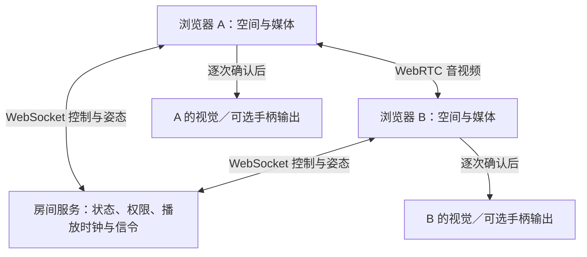

# Rove 如晤：首版技术架构

版本：0.1；文档日期：2026-10-20。

本仓库开始把 Rove 从研究展示推进到可运行的双人空间联调。当前交付是**桌面浏览器技术原型**：用户可以进入同一房间、交换头手控制点、同步观看测试片、请求一次触碰回应，并选择开启真实 WebRTC 音视频。它尚未完成真实房间扫描、真人重建或实体腕带接入。

这里的“已实现”指代码包含相应行为，不等于所有设备、浏览器和网络环境均已实测。实际执行结果应由对应测试记录和设备记录说明。

## 1. 基线与产品关系

源仓库为 [Angelina-G/rove-site](https://github.com/Angelina-G/rove-site)，冻结基线提交为 `d0b026570fdaefb73a339d27bf2455073fb93c5a`。基线的 **64 个文件（4 个 HTML、59 个 PDF、1 张 PNG）保留在原路径**，可通过应用内 `/research/` 阅读。PDF 数量是文件数量，不代表独立论文数量或已阅读全文数量。

主要产品依据是 [rove-overview.html](../rove-overview.html) 中的交互流程、`scenarios.live`、`layers`、`flows` 和 `roadmap`：先选主场、接受邀请，再进入同一空间；语音、动作和共同观看构成首次体验，触碰按双方选择逐步加入。

当前原型把“主场”落实为创建者提供一个程序化样例空间，来访者接受邀请后使用相同坐标。两种房间预设是样例的颜色选择，**没有扫描 A/B 的真实房间，也没有实现会话中交换主场提供者**。更完整的 A′/B′ 主场交换仍是后续任务。

## 2. 已实现与尚未实现

| 能力 | 当前代码行为 | 输入或输出性质 | 尚需验证／开发 |
|---|---|---|---|
| 双人会话 | 随机房间码、预览、接受加入、满员拒绝、离开清理 | 真实 HTTP/WebSocket 服务 | 跨机器部署、访问控制与运行保障 |
| 共享三维房间 | Three.js 程序化客厅与同一坐标系 | 样例几何 | 房间扫描、锚点持久化、配准误差 |
| 人物和动作 | 头部与左右手位姿驱动简化化身 | 默认桌面键鼠控制；不是人体动作捕捉 | 人体外形、全身动作、口型、注视与遮挡 |
| WebXR 入口 | 支持能力检测、AR/VR 会话、头部及双手输入读取 | 设备提供输入时走真实 WebXR API | 实体头显兼容、追踪稳定性和空间校准 |
| 音视频 | WebRTC 点对点媒体、服务端转发 SDP/ICE、权限按钮 | 真实浏览器媒体管线 | 两个实际网络的 TURN 联通、真人语音质量 |
| 共同观看 | 两端播放仓库内 24 秒测试片，同步播放状态与时间点 | 真实本地视频播放；样例内容 | 长片、缓冲与恢复、共同内容授权、字幕 |
| 触碰 | 双方允许请求、右手接近检测、接收方逐次确认、过期清理 | 真实协议事件 | 更完整的身体区域与触碰词汇 |
| 触觉反馈 | 默认视觉脉冲；用户可选择浏览器游戏手柄振动 | 视觉为模拟；手柄返回浏览器 API 结果 | 实体腕带驱动、传感器回执、物理延迟 |
| 诊断 | 服务往返时延、姿态包计数、播放时钟偏差、媒体字节、事件导出 | 运行时观测值 | 动作到画面、事件到真实致动的端到端测量 |

## 3. 组件和数据路径

有 TURN 配置时，WebRTC 可以通过 TURN 中继媒体；图中的媒体边表示逻辑媒体连接，不保证网络中一定直连。首版**没有把姿态或触碰放入 WebRTC DataChannel**：它们走房间 WebSocket，服务端可以检查会话、权限、序号与触碰条件。后续改传输方式必须保留这些语义。

| 文件 | 职责 |
|---|---|
| [server/index.ts](../server/index.ts) | HTTP 静态资源、配置、双人房间、WebSocket 信令与消息转发、播放时钟、接触和逐次同意状态机、清理与流量边界 |
| [shared/protocol.ts](../shared/protocol.ts) | 消息联合类型、空间单位、时间相关常量、播放位置计算 |
| [shared/validation.ts](../shared/validation.ts) | 闭合字段校验、数值边界、位姿范围、输入长度；拒绝不认识的字段 |
| [web/src/main.ts](../web/src/main.ts) | 用户操作、会话界面、客户端状态、时钟估计、权限与退出、诊断导出 |
| [web/src/scene.ts](../web/src/scene.ts) | 程序化场景、头手化身、桌面输入、WebXR 入口、跟踪失效淡出、视频屏幕 |
| [web/src/media.ts](../web/src/media.ts) | 媒体采集、Perfect Negotiation、ICE、远端播放、媒体统计与设备关闭 |
| [web/src/haptics.ts](../web/src/haptics.ts) | 视觉输出、可选手柄 API、限幅、停止、过期异步任务失效与重复事件防护 |
| [tests/server.test.ts](../tests/server.test.ts) | 使用真实 HTTP/WebSocket 连接测试服务端协议与状态边界 |
| [tests/haptics.test.ts](../tests/haptics.test.ts) | 用模拟的浏览器设备接口检查触觉适配器的限幅、取消和回退；不替代实体硬件测试 |

开发环境由 Node.js 服务嵌入 Vite 中间件。构建后，生产模式从 `dist/` 提供前端文件，同时保留 `/ws` 和 `/api/` 服务。依赖与命令以根目录 [package.json](../package.json) 为准；没有数据库、账户服务、媒体录制服务或云存储。

## 4. 会话和权限

房间 ID 是 16 个随机字节形成的 32 位小写十六进制字符串。邀请链接把它放在 `#room=` 中；客户端通过 WebSocket 发出查看和加入请求。持有链接者可尝试加入，当前没有账户身份认证或创建者二次审批。

创建者的协议角色为 `host`，来访者为 `guest`。来访者退出后，主场继续等待；主场退出后，会话结束且房间被清理。WebSocket 重连产生新参与者 ID，不自动继承旧会话或权限。

四种用户动作保持分开：进入共享空间、开启麦克风／摄像头、允许触碰请求、接受本次触碰。开启音视频不是允许触碰；允许请求也不代表每次输出均已同意。首版没有录制入口。

触碰资格由服务端检查：两人在同一房间、均允许请求、会话未暂停、两边位姿仍有效；接收者再对单次请求选择接受或拒绝。换人、离开、撤回、停止、请求过期或追踪失效都会取消相应的待处理请求。具体条件见 [PROTOCOL.md](PROTOCOL.md)。

## 5. 空间输入与显示

统一使用米制、右手坐标系，`+Y` 向上，四元数顺序为 `[x, y, z, w]`。桌面模式约每 50 毫秒发布一次头手帧，位置由用户按钮／键盘操作生成。`source: "desktop"` 和 `tracked: true` 只表示这份桌面输入当前有效，不表示真实人体被传感器跟踪。

远端姿态按序号拒绝旧帧，并在渲染时插值。超过 1 秒没有有效姿态时，化身淡出，触碰不能继续依据旧位置执行。浏览器切到后台或失焦会暂停桌面追踪。

WebXR 使用 `local-floor` 参考空间，读取头部及左右控制器 grip pose 或手腕关节。缺少任意一只手时标记追踪失效，不补出一只“已跟踪”的手。重新定位通过水平位移和朝向把本地输入映射到样例空间，**不是两间真实房间的自动配准**。AR 模式隐藏程序化房间背景，没有扫描 mesh、真实遮挡、空间锚持久化或环境理解。

## 6. 音视频与播放时钟

`MediaLink.enable()` 才调用 `getUserMedia()`。先开音频再开视频时保留已有音轨和 PeerConnection；离开或对端换人时关闭设备。尚在等待权限的请求若迟到，得到的轨道也会立即停止。

媒体协商采用 W3C 的 [Perfect Negotiation](https://www.w3.org/TR/webrtc/#perfect-negotiation-example)：主场为 impolite，来访者为 polite，处理同时发 offer 的冲突。信令逐条处理，提前到达的 ICE 候选排队。远端声音默认不静音；浏览器阻止自动播放时提示用户主动播放。

服务器通过 `/api/config` 提供 ICE 配置；没有有效 TURN 环境配置时返回空数组。此时优先在本机／局域网验证，不能据此承诺跨网络连接。TURN 凭据会下发给客户端，应使用受限、短时凭据，不能把管理密钥填进去。

共同观看由服务端保存 `playing / position / updatedAt / revision`。浏览器每 2 秒发送 ping，以往返耗时估计服务端时钟偏移；播放位置偏差超过约 250 毫秒时调整本地视频位置。这是简单的同步策略，不包含精确的音视频同步控制或严格时钟同步保证。测试片已经随应用提供，不涉及外部影视平台内容接入。

## 7. 触觉输出的证据层次

`HapticOutput` 默认只显示视觉脉冲。用户选择本机手柄且浏览器检测到可用 actuator 后，才尝试 `dual-rumble`。幅值上限为 `0.2`，持续时间上限为 `100 ms`，不支持时回退为视觉输出。

输出回执有两个层次：

- `mode: "visual", ok: true`：客户端已调用视觉回应，不证明有物理触感。
- `mode: "gamepad", ok: true`：浏览器振动 API 报告完成，不证明佩戴者感受到振动，也不是腕带传感器的真实测量。

服务端校验回执属于预期接收者和已投递事件，但不能独立验证客户端对设备状态的陈述。真实腕带需要自己的设备身份、命令确认、采样时钟、驱动限幅、断连停止和传感器测量，不能只把现有 `ok` 改名为硬件成功。

## 8. 保存、测量与部署边界

服务端房间、位姿、请求和投递状态仅在内存中，不写入数据库。客户端诊断仅保存在页面内存，点击导出才形成 JSON；当前导出不包含音视频、邀请房间码或原始位姿坐标。应用未实现录制。

诊断中的 RTT 是客户端到房间服务的往返时间；播放偏差是本地播放器与估计共享时钟的差值；RTP 字节是浏览器媒体统计。它们都不能替代动作到画面或触碰到执行器的端到端测量。

服务默认绑定 `127.0.0.1:5173`。HTTPS、有效证书、跨机器可达性、反向代理 WebSocket 升级、TURN、访问控制、日志保留和服务重启均需在实际部署中配置和验证。HTTP 原型自身不提供 TLS，不能把 WebRTC 媒体加密表述成整个应用所有数据已经端到端加密。

## 9. 本架构暂不承担的内容

首版未实现真人体积重建、VRM 导入、全身 IK／动作捕捉、HRTF 空间音频、真实房间 mesh 同步、物理碰撞保护、腕带驱动、力／温度反馈、EEG／EMG、梦境通信或机器人遥操作。旧报告中的性能估计和“研究空白”判断应按原始文献重新核验，不能作为本系统已经达到的结果。

下一阶段的工作与验收见 [ROADMAP.md](ROADMAP.md)。
